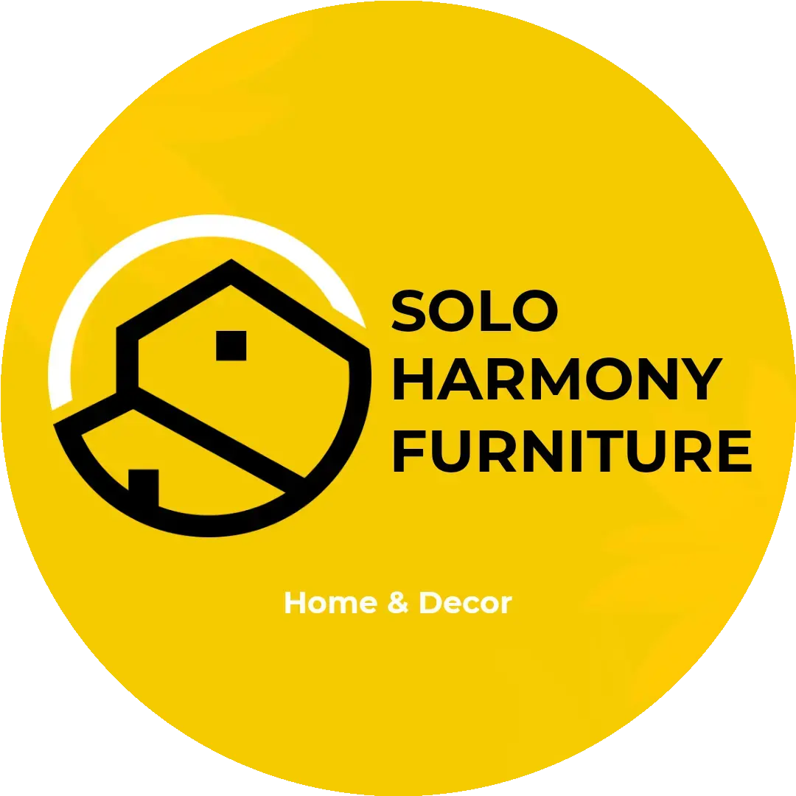
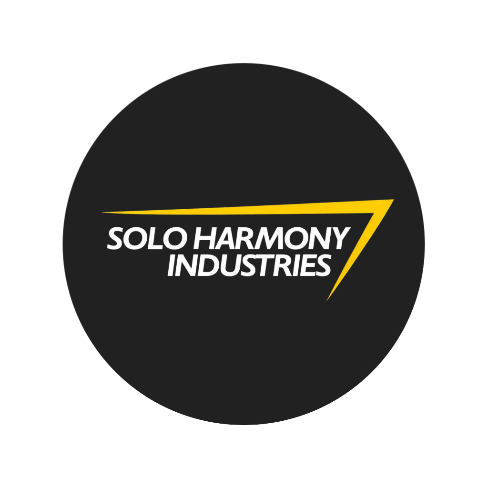

# Logo Solo Harmony

Pustaka publik logo **Solo Harmony Furniture**, **Solo Harmony Renovation / Renov**,
dan **Solo Harmony Industries / Office**. Repositori ini disiapkan atas permintaan
pemilik agar staf dan ChatGPT dapat menemukan serta mengambil logo dari satu tempat.

**Mulai dari [katalog logo](CATALOG.md)**. Tersedia **16 varian logo dan 6 ikon aplikasi**,
diperiksa pada **12 Oktober 2026**. Seluruh berkas gambar disalin byte-for-byte dari
arsip pemilik atau aset aplikasi yang sudah tersedia, tanpa menggambar ulang.

| Furniture | Renovation | Industries / Office |
|---|---|---|
|  |  |  |

## Pilih logo sesuai kebutuhan

| Kebutuhan | Berkas yang disarankan |
|---|---|
| Kantor / Office, PNG transparan | [Industries / Office 1024](logos/industries/logo-solo-harmony-office-industries-1024.png) |
| Holding / Industries resolusi besar | [Industries 2000, kanvas putih](logos/industries/logo-solo-harmony-industries-bulat-2000.png) |
| Profil Furniture bulat kuning | [Furniture 1080 WebP](logos/furniture/logo-solo-harmony-furniture-bulat-kuning-1080.webp) |
| Profil Furniture dalam format JPG | [Furniture 540 JPG](logos/furniture/logo-solo-harmony-furniture-bulat-kuning-540.jpg) |
| Furniture transparan berwarna | [Furniture warna 1080 PNG](logos/furniture/logo-solo-harmony-furniture-warna-1080.png) |
| Furniture putih untuk latar gelap | [Furniture putih 1080 PNG](logos/furniture/logo-solo-harmony-furniture-putih-1080.png) |
| Watermark Furniture | [Wordmark emas transparan 2172 x 724](logos/furniture/logo-solo-harmony-furniture-wordmark-transparan.png) |
| Furniture untuk sponsor, kanvas putih | [Wordmark 2000 PNG](logos/furniture/logo-solo-harmony-furniture-wordmark-latar-putih-2000.png) |
| Profil Renov / Renovation | [Renov hijau 150 PNG](logos/renovation/logo-solo-harmony-renovation-bulat-hijau-150.png) |
| Renov putih horizontal, latar hitam | [Renov putih 1583 x 803 JPG](logos/renovation/logo-solo-harmony-renovation-putih-latar-hitam.jpg) |

Nama file Office merujuk ke logo **Industries**. Jika permintaan hanya menyebut
"logo Solo Harmony", tentukan unit Furniture, Renovation, atau Industries dari
konteks pekerjaan sebelum mengambil berkas.

## Dipakai dari ChatGPT kantor

Gunakan [panduan ChatGPT](docs/panduan-chatgpt.md) untuk menghubungkan repo melalui
GitHub atau membaca tautan publik secara langsung.

Contoh permintaan:

> Baca katalog di https://raw.githubusercontent.com/arizaltp-afk/solo-harmony-brand-assets/main/CATALOG.md.
> Ambil logo Solo Harmony Office PNG transparan untuk dokumen kantor. Gunakan file
> asli dari katalog, pertahankan warna dan proporsinya, lalu sertakan tautan sumber.

Indeks tersedia dalam beberapa format:

- [CATALOG.md](CATALOG.md): daftar semua varian beserta tautan unduh asli.
- [manifest.json](manifest.json): merek, penggunaan, dimensi, transparansi, sumber, URL, dan SHA-256.
- [llms.txt](llms.txt): pintu masuk ringkas untuk pembaca AI.
- [SHA256SUMS](SHA256SUMS): pemeriksaan keutuhan berkas.

Repo berstatus publik memungkinkan akses tanpa izin repo privat. Akun ChatGPT
tetap memerlukan koneksi GitHub yang sesuai atau kemampuan membuka tautan web.
Publikasi repo tidak otomatis mengaktifkan koneksi pada akun ChatGPT lain.

## Keaslian dan batas arsip

- "Asli" di sini berarti berkas yang ditemukan dalam arsip pemilik atau aplikasi,
  disalin tanpa perubahan byte. Ini bukan klaim bahwa seluruh master desain editable
  sudah ditemukan atau bahwa varian lama menggantikan identitas yang sedang digunakan.
- Ekspor Furniture warna, putih, dan bulat memiliki rekaman Drive sejak 2023.
  File Renov putih memiliki rekaman sejak 2023 dengan pembaruan versi pada 2026.
- Logo bulat Furniture, logo hijau Renov, logo Office, dan watermark aplikasi telah
  dicocokkan dengan berkas yang dilayani situs masing-masing saat pemeriksaan.
- Master editable AI/CDR/EPS/SVG resmi belum terverifikasi. Koneksi Canva memerlukan
  autentikasi ulang; ekspor yang sudah tersimpan tetap tersedia di sini.
- Logo Renov hijau yang ditemukan hanya 150 x 150. Jangan menyatakan resolusinya
  cukup untuk cetak besar. Versi Renov putih adalah JPG berlatar hitam, bukan transparan.
- SVG dalam `application-icons/` adalah simbol favicon sederhana, bukan master
  vektor logo merek. Ikon aplikasi tidak menjadi pilihan utama materi promosi.
- Nama sumber tertentu tidak cocok dengan format isinya. Ekstensi pada repo ini
  mengikuti format sebenarnya, tanpa konversi gambar. Rincian ada di manifest.
- Duplikat identik disimpan sekali. Varian berukuran atau berformat berbeda tetap
  dicatat. Dua wordmark Furniture memiliki piksel sama tetapi encoding berbeda.

Hak merek dan logo tetap pada pemiliknya. Akses publik tidak mengubah kepemilikan.

## Pemeliharaan

Simpan varian baru di folder mereknya dengan nama deskriptif. Perbarui katalog,
manifest, checksum, dan pilihan cepat hanya setelah memeriksa sumber serta tampilan.
Pertahankan file yang sudah dipakai melalui tautan publik; tambahkan varian baru
dengan nama baru agar dokumen lama tetap dapat mengambil asetnya.

Publikasikan hanya materi merek yang memang boleh dibagikan. Bukti internal,
file bisnis, dan akses akun tidak termasuk isi pustaka ini.
